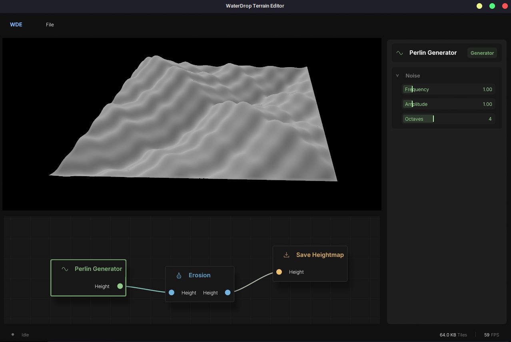

<p align="center">
    
</p>

# WaterDropEngine


## Presentation
**WaterDropEngine** (<i>WDE</i>) is a 3D game engine in Rust.

As its name suggests, it is designed to be *small, simple and efficient*. It is also **my personal project**, so it is not intended to be used by other people, but rather to be a playground for me to learn and experiment with game engine development.

*Therefore, I do not intend to make it a full-featured engine, but rather to focus on the core features that I find interesting and useful for my own projects.
I will not take into account pull requests or issues from other people, but I will be happy to answer any questions or give any advice to anyone who wants to learn game engine development.*


## Demo
**[WaterDrop Terrain Generator](https://github.com/explorablescience/WaterDropTerrainGenerator)** is a node-based terrain generation and erosion tool built on top of *WaterDropEngine*, and is the main project currently exercising it.

<p align="center">
    
</p>


## Documentation
The documentation of the engine is available on the Github Pages of the project **[at this link](https://explorablescience.github.io/WaterDropEngine/wde/)**. It is generated using GitHub Actions, so it is automatically updated every time I push a new commit to the main branch.


## Dependencies
At its core, *WaterDropEngine* relies on:
- **[Bevy's ECS](https://bevyengine.org/)** for the Entity Component System.
- **[wgpu](https://wgpu.rs/)** for rendering, with a custom renderer built on top of it.
- **[Rapier](https://rapier.rs/)** for physics and simple ray casting.


## Using the engine
To start using *WaterDropEngine*, you will need to have Rust installed on your computer. If you don't have it, you can install it by following the instructions on the [official website](https://www.rust-lang.org/tools/install).

Then, clone the repository using `git clone https://github.com/explorablescience/WaterDropEngine.git`, and run the examples with:
```bash
cargo run --bin wde-examples --package wde-examples --features log-debug,debug,watch
```

To build your own project on it, clone it next to your project and depend on the `wde` crate by path. Its modules are behind Cargo features, with three presets: `minimal` (the default: PBR rendering, cameras and glTF models), `full` (every runtime module, terrain and physics included) and `everything` (`full` plus the in-game editor tools):
```toml
[dependencies]
wde = { path = "../WaterDropEngine/crates/core/wde", features = ["full"] }
```
The engine assets (shaders, placeholder textures) are in `res/core/`: your project should expose them as its own `res/core/` folder, for example with a symbolic link created by its `build.rs`.

